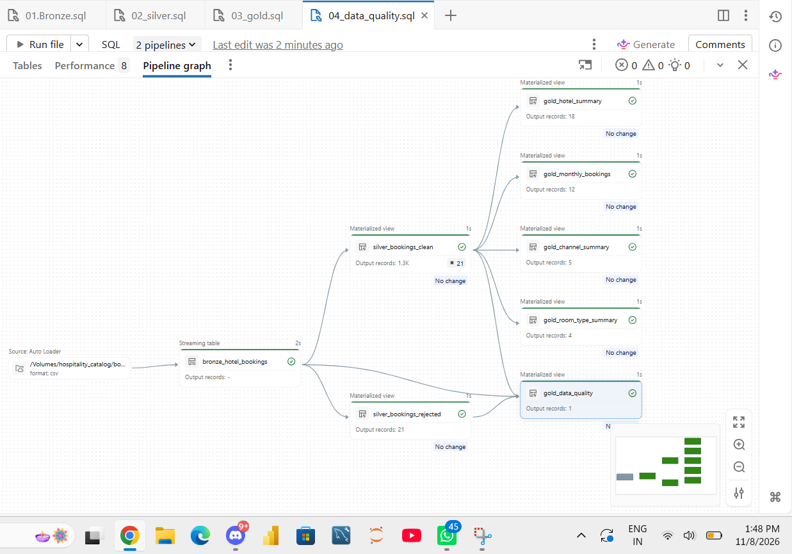
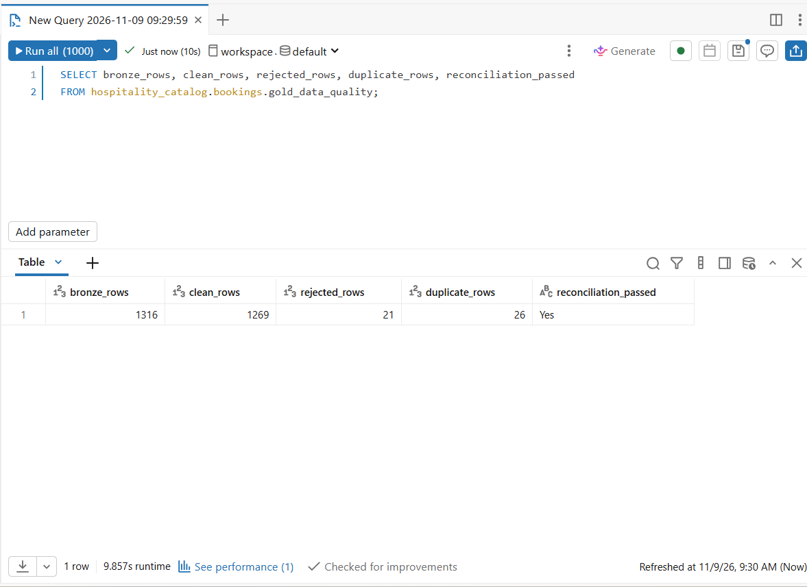
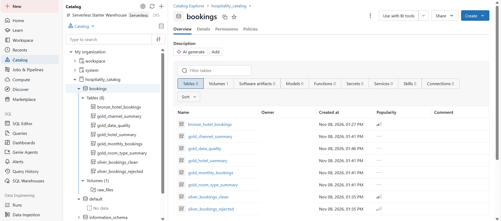
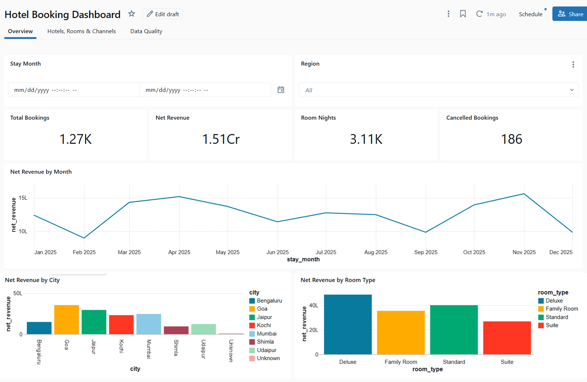
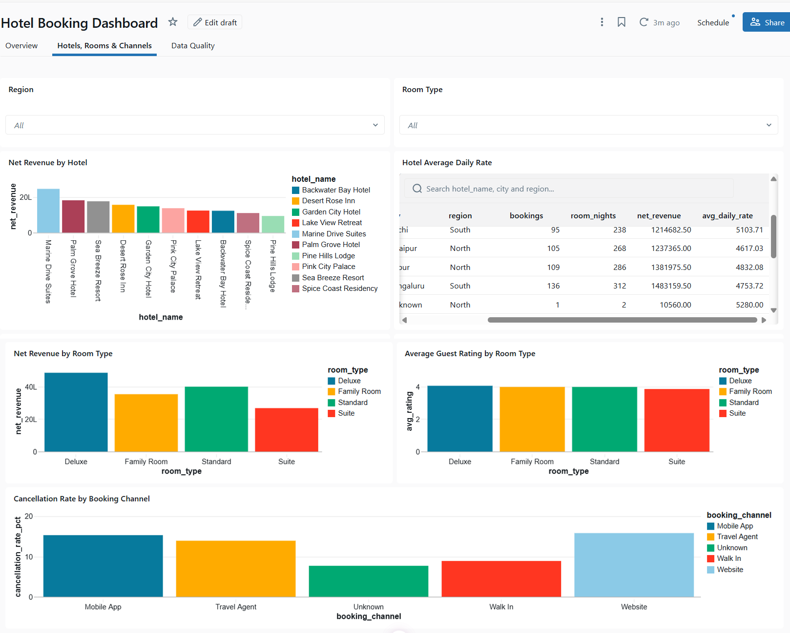
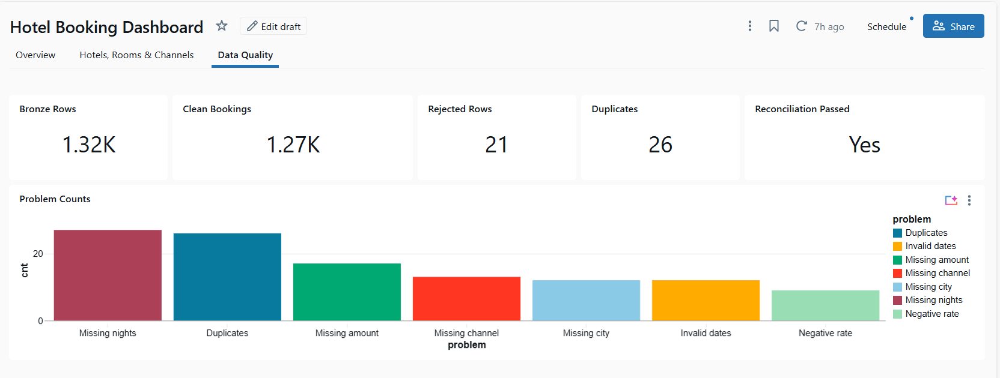

# Hotel Booking Analytics Platform: Medallion Architecture on Databricks

A Lakeflow Spark Declarative Pipelines project (SQL) that turns a messy hotel bookings CSV into
trusted Gold tables and a Databricks AI/BI dashboard.

## Architecture
Source CSV -> Bronze -> Silver (clean + rejected) -> Gold (5 tables) -> AI/BI Dashboard

## Tools
Databricks, Unity Catalog Volume, Lakeflow Spark Declarative Pipelines, SQL, Databricks AI/BI

## Dataset
Synthetic file `hotel_bookings_raw.csv`: 1,316 rows, 20 columns, hotel stays in 2025.
It contains no real guest data.

## Project structure
- `data/`: the raw CSV
- `pipeline/`: the 4 SQL files (Bronze, Silver, Gold, Data Quality)
- `docs/`: cleaning rules
- `screenshots/`: pipeline graph, data quality result, dashboard pages

## How to run
1. In Databricks, create the catalog `hospitality_catalog`, schema `bookings` and volume `raw_files`.
2. Upload `data/hotel_bookings_raw.csv` into the volume.
3. Create an ETL pipeline, set the default catalog to `hospitality_catalog` and the schema to `bookings`.
4. Add the 4 SQL files from `pipeline/` and click Run pipeline.
5. Open `gold_data_quality` and check that reconciliation_passed = Yes.
6. Build the AI/BI dashboard on the Gold tables.

## Results
| Metric | Value |
|---|---|
| Bronze rows | 1,316 |
| Clean rows | 1,269 |
| Rejected rows | 21 |
| Duplicates removed | 26 |
| Reconciliation | Passed |
| Cancelled bookings | 186 |

## Cleaning rules
See [docs/cleaning_rules.md](docs/cleaning_rules.md)

## Screenshots

### Pipeline graph

### Data quality result

### Gold tables

### Dashboard: Overview

### Dashboard: Hotels, Rooms and Channels

### Dashboard: Data Quality

